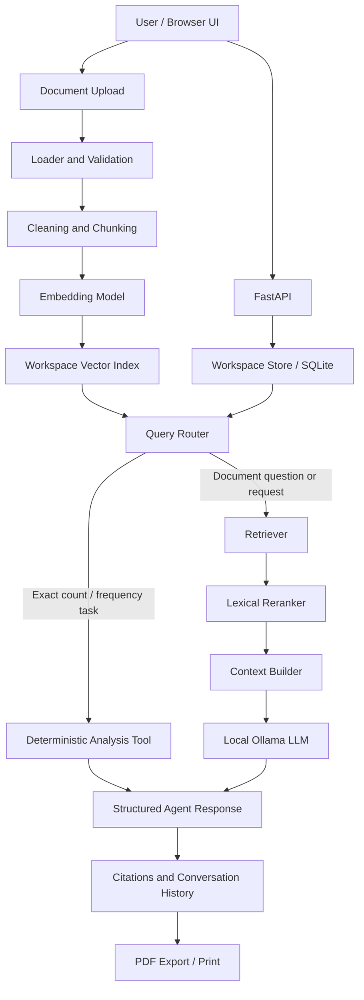

# Tungelligence — Document-Grounded Agentic RAG

[](https://www.python.org/)
[](https://fastapi.tiangolo.com/)
[](https://ollama.com/)
[](https://github.com/facebookresearch/faiss)
[](https://pytest.org/)
[](LICENSE)

> **A portfolio and educational engineering demonstration — not a hardened production service.**

Tungelligence is a local-first application for asking questions about documents, carrying out document-oriented tasks, and inspecting the evidence behind an answer. It combines a custom, bounded agent workflow with document ingestion, semantic retrieval, lightweight reranking, a locally hosted language model, deterministic text-analysis tools, persistent workspaces, and a browser-based interface.

The project is designed to demonstrate how the components of a practical AI application fit together. Its core orchestration is implemented in explicit Python modules rather than hidden behind a single high-level chain or framework call.

## Why this project

A document assistant needs more than a chat box connected to an LLM. It needs a repeatable ingestion path, a searchable representation of source material, an explicit strategy for selecting context, predictable behavior when evidence is weak, persistence for conversations, and an interface that makes the workflow understandable.

Tungelligence brings these concerns together in an inspectable portfolio project. It also separates tasks that require language-model generation from exact operations that are better handled by ordinary Python code.

## Key capabilities

- **Workspace-based knowledge bases** — documents, indexes, conversations, and message history are organized by workspace.
- **Document ingestion** — accepts text-based PDF, DOCX, TXT, and Markdown files, with configurable file-size and chunking limits.
- **Semantic retrieval** — uses Sentence Transformers embeddings and FAISS by default.
- **Candidate reranking** — applies a lightweight lexical reranker after vector retrieval.
- **Local LLM inference** — uses Ollama's HTTP API; `qwen3:8b` is the configured default model.
- **Bounded agent orchestration** — routes deterministic analysis and document-grounded requests through different paths, with a finite decision flow rather than an open-ended autonomous loop.
- **Document-oriented tasks** — supports natural-language requests such as summarization, explanation, comparison, translation, extraction, and drafting from workspace content, subject to the available context and model quality.
- **Deterministic text analysis** — handles supported letter-frequency, word-frequency, word-count, and character-count requests without invoking LLM generation.
- **Conversation history** — persists messages and supplies a bounded amount of recent history for follow-up questions.
- **Evidence visibility** — returns source references and a heuristic confidence score alongside the answer.
- **PDF reporting** — offers a browser-based Export flow and a separate Print flow.
- **Developer tooling** — includes a CLI, automated tests, a GitHub Actions workflow, and a Docker Compose development setup.

## Architecture



### Request lifecycle

1. A user creates a workspace and uploads supported documents.
2. The ingestion pipeline validates and extracts text, cleans it, splits it into chunks, and validates the resulting records.
3. The configured embedding backend converts chunks into vectors. The selected vector-store backend persists the index and its chunk metadata.
4. A question is routed to a deterministic analysis tool when it matches a supported exact-analysis operation; otherwise, the agent retrieves and reranks candidate chunks.
5. When relevant context is available, the generator sends a bounded prompt and source material to the configured LLM. Broad requests can use a bounded selection of workspace chunks when top-k retrieval alone is not sufficient.
6. The application returns the response, available citations, action label, and heuristic confidence value, and persists the conversation turn.

An empty workspace is rejected before agent execution. When the agent cannot assemble usable evidence, it can return an insufficient-context response without making an LLM generation request.

## Technology stack

| Area | Implementation | Purpose |
|---|---|---|
| Runtime | Python `>=3.12,<3.14` | Application and orchestration code |
| API | FastAPI, Pydantic | HTTP endpoints and input/output validation |
| Browser UI | HTML, CSS, JavaScript | Workspace and conversation experience |
| LLM | Ollama, default `qwen3:8b` | Local natural-language generation |
| Embeddings | Sentence Transformers, `all-MiniLM-L6-v2` | Dense document and query vectors |
| Vector search | FAISS | Similarity search over embeddings |
| Offline smoke-test option | Hash embeddings and NumPy vector storage | Exercise application flow without downloading embedding models or requiring FAISS |
| Persistence | SQLite and workspace files | Workspaces, documents metadata, conversations, and derived artifacts |
| PDF | ReportLab | Generate downloadable reports |
| Testing | pytest, pytest-cov, HTTPX | Unit/integration checks and coverage reporting |
| Automation | GitHub Actions, Docker Compose | CI checks and a local container-based setup |

The offline hash/NumPy configuration is for pipeline validation only. Hash embeddings are not a semantic replacement for a trained embedding model. Natural-language generation still requires the configured LLM service.

## Supported documents and current limitations

| Format | Current behavior | Limitation |
|---|---|---|
| `.txt` | Reads UTF-8 text | Non-UTF-8 files are rejected |
| `.md`, `.markdown` | Reads UTF-8 Markdown source | Markdown is indexed as text; it is not rendered |
| `.pdf` | Extracts text with `pypdf` | Image-only/scanned PDFs are not OCR-processed and may be rejected when no text is extractable |
| `.docx` | Extracts non-empty paragraphs | Word tables and other embedded objects are not currently extracted |

CSV, Excel, HTML, images, and other formats are not in the current loader allow-list. The configured maximum file size is 25 MB by default and can be changed in `.env`.

The reranker is lexical, not a cross-encoder. The confidence value is an application heuristic, **not a calibrated probability** that the answer is correct. Context is bounded; very large workspaces may not fit in full into one generation request. Always verify important claims against the cited source documents.

## Quick start — Windows PowerShell

The following commands use the virtual environment's Python executable directly, so PowerShell script activation policy does not need to be changed.

```powershell
# From the repository root; use Python 3.12 or 3.13.
py -3.12 -m venv .venv

# Install the project and its development/test dependencies.
.\.venv\Scripts\python.exe -m pip install --upgrade pip
.\.venv\Scripts\python.exe -m pip install -e ".[dev]"

# Create local configuration from the checked-in template.
Copy-Item .env.example .env
```

Install and start [Ollama](https://ollama.com/download), then download the configured model:

```powershell
ollama pull qwen3:8b
ollama list
```

Start the web application bound to the local machine only:

```powershell
.\.venv\Scripts\python.exe -m uvicorn app.api.main:app --reload --host 127.0.0.1 --port 8000
```

Open `http://127.0.0.1:8000`. Create a workspace, upload a document, wait for indexing to finish, and then start a conversation. The embedding model may need to download from the model registry on first use.

If `py -3.12` is not available, install Python 3.12 or 3.13 and use that interpreter to create the virtual environment. The project metadata does not currently declare Python 3.14 as supported.

## Quick start — macOS / Linux

```bash
python3.12 -m venv .venv
source .venv/bin/activate
python -m pip install --upgrade pip
python -m pip install -e ".[dev]"
cp .env.example .env
ollama pull qwen3:8b
python -m uvicorn app.api.main:app --reload --host 127.0.0.1 --port 8000
```

Open `http://127.0.0.1:8000`. Keep the local LLM endpoint set to `http://localhost:11434` for native development.

## First-use walkthrough

1. Create a workspace, for example **Product Documentation**.
2. Upload `examples/getting_started.txt` from the repository.
3. Wait for the indexing overlay to finish and confirm that the document appears in the workspace.
4. Try a knowledge question: `What is the annual leave entitlement?`
5. Ask a follow-up: `Who approves it?`
6. Try an exact analysis request: `What is the most frequent letter in the documents?`
7. Ask for a document transformation: `Summarize the document in five bullet points.`
8. After a response completes, use **Export** to choose a PDF save location or **Print** to open the browser/system print dialog.

The exact-analysis examples use Python tools and do not need LLM generation. Knowledge questions and document transformations use the local LLM when usable workspace context is available.

## Configuration

Copy `.env.example` to `.env` and adjust the settings as needed.

| Setting | Default | Meaning |
|---|---|---|
| `LLM_BASE_URL` | `http://localhost:11434` | Ollama-compatible API endpoint |
| `LLM_MODEL` | `qwen3:8b` | Model name already available in the configured Ollama instance |
| `LLM_TIMEOUT_SECONDS` | `180` | LLM request timeout |
| `EMBEDDING_PROVIDER` | `sentence_transformers` | `sentence_transformers` or `hash` |
| `EMBEDDING_MODEL` | `sentence-transformers/all-MiniLM-L6-v2` | Sentence Transformers model identifier |
| `VECTOR_STORE_BACKEND` | `faiss` | `faiss` or `numpy` |
| `EMBEDDING_DIMENSION` | `384` | Expected embedding dimension; use `128` for the hash/NumPy smoke-test configuration |
| `TOP_K` | `8` | Initial retrieval candidate count |
| `RERANK_TOP_K` | `4` | Number of candidates kept after reranking |
| `CHUNK_SIZE` | `800` | Target chunk size |
| `CHUNK_OVERLAP` | `120` | Overlap between adjacent chunks |
| `MAX_DOCUMENT_SIZE_MB` | `25` | Upload size limit per document |
| `CONVERSATION_HISTORY_MESSAGES` | `12` | Recent messages available to follow-up requests |
| `MAX_CONTEXT_CHARS` | `28000` | Character budget for selected workspace context |

For a model-download-free indexing smoke test, set the following in `.env`:

```dotenv
EMBEDDING_PROVIDER=hash
VECTOR_STORE_BACKEND=numpy
EMBEDDING_DIMENSION=128
```

Restart the application after changing settings. This mode validates ingestion, persistence, and basic search plumbing; it is not a quality benchmark and does not replace semantic embeddings.

## API overview

FastAPI's interactive API documentation is available at `http://127.0.0.1:8000/docs` while the service is running.

| Method | Endpoint | Purpose |
|---|---|---|
| `GET` | `/health` | Basic service liveness and version response; it does not verify that Ollama or the embedding model is ready |
| `GET` | `/v1/workspaces` | List workspaces |
| `POST` | `/v1/workspaces` | Create a workspace |
| `GET` | `/v1/workspaces/{workspace_id}` | Load workspace state, including document and conversation summaries |
| `PATCH` | `/v1/workspaces/{workspace_id}` | Rename a workspace |
| `DELETE` | `/v1/workspaces/{workspace_id}` | Delete a workspace and its local workspace directory |
| `GET` | `/v1/workspaces/{workspace_id}/conversations` | List conversations |
| `POST` | `/v1/workspaces/{workspace_id}/conversations` | Create a conversation |
| `DELETE` | `/v1/workspaces/{workspace_id}/conversations/{conversation_id}` | Delete a conversation and its stored messages |
| `POST` | `/v1/workspaces/{workspace_id}/conversations/{conversation_id}/reset` | Clear message history while retaining the conversation record |
| `GET` | `/v1/workspaces/{workspace_id}/conversations/{conversation_id}/messages` | Read conversation history |
| `POST` | `/v1/workspaces/{workspace_id}/documents` | Upload and index documents |
| `POST` | `/v1/workspaces/{workspace_id}/documents/delete` | Delete selected documents and rebuild the remaining workspace index |
| `POST` | `/v1/workspaces/{workspace_id}/conversations/{conversation_id}/query` | Submit a workspace-grounded chat request |
| `POST` | `/v1/report` | Generate a PDF from a completed agent response |
| `POST` | `/v1/query` | Deprecated legacy endpoint; the normal application flow uses workspace conversations |

## Tests and quality checks

Run these commands from the repository root:

```powershell
.\.venv\Scripts\python.exe -m compileall app tests
.\.venv\Scripts\python.exe -m pytest -q
.\.venv\Scripts\python.exe -m pytest --cov=app --cov-report=term-missing
```

On macOS/Linux, replace the executable path with `python` after activating `.venv`.

The upload handler stages all selected files before changing the active workspace, and restores same-name source files if indexing fails. The shared artifact publisher uses a backup-and-rollback flow for its managed output files. The suite uses deterministic test doubles for external services where possible, allowing CI to run without a live Ollama server or a remote model download. A passing unit/integration suite does not by itself prove the native FAISS/Sentence Transformers path, Docker build, or live Ollama inference works on every operating system; validate those separately in the intended environment.

## Data storage and deletion behavior

Workspace data is stored locally:

- `data/tungelligence.db` — workspace, document metadata, conversation, and message records.
- `data/workspaces/<workspace-id>/raw/` — uploaded source files.
- `data/workspaces/<workspace-id>/processed/` — persisted processed chunks.
- `data/workspaces/<workspace-id>/vector/` — vector index and its chunk metadata.

Deleting a document removes its source file and rebuilt index records. **It does not automatically erase historical conversation messages** that may quote or summarize the deleted document. If those messages contain information that should no longer be retained, delete the relevant conversation or the entire workspace as well. Application-level deletion is not a guarantee of forensic secure erasure from disks, backups, snapshots, or external copies.

## Docker Compose (development only)

Before starting Compose, create `.env` from `.env.example`, because the Compose file references it. Compose stores Ollama model data in a named Docker volume; it does not copy workspace files into the image. Then run:

```powershell
Copy-Item .env.example .env

docker compose -f docker/docker-compose.yml up --build -d
docker compose -f docker/docker-compose.yml exec ollama ollama pull qwen3:8b
```

The API container uses `http://ollama:11434`; native Windows/macOS/Linux execution uses `http://localhost:11434` by default.

**Network boundary:** Compose publishes the API only on `127.0.0.1:8000`; the Ollama port is not published to the host. The API still has no authentication or user authorization, so do not override the loopback binding or expose the stack to a LAN/public internet. See [SECURITY.md](SECURITY.md).

## Known limitations and responsible use

- The project is a portfolio/demo implementation, not a production-hardened multi-user service.
- The API does not implement authentication, per-user authorization, rate limiting, or tenant isolation.
- Uploaded documents are untrusted input. Prompt-injection content in documents may influence model behavior; the current prompt is not a security boundary.
- Extracted PDF text may be incomplete, and scanned/image-only PDFs are not OCR-processed.
- DOCX table content is not currently ingested.
- Retrieval and context budgets limit what the model sees. Long documents and large workspaces may require a future hierarchical or map-reduce summarization strategy.
- The lexical reranker and confidence values are pragmatic baseline components, not state-of-the-art ranking or calibrated reliability measures.
- LLM responses can be incomplete or incorrect. Review source citations and verify high-impact conclusions independently.
- The default LLM target is local Ollama. If `LLM_BASE_URL` is changed to a remote service, prompts and selected document content may be transmitted to that endpoint.

## License

Distributed under the MIT License. See [LICENSE](LICENSE).

## Author and related work

**Tunç KUL — Computer Engineer**  
GitHub: [@tnctungkl](https://github.com/tnctungkl)

Related portfolio project: [Sentiment End-to-End MLOps](https://github.com/tnctungkl/sentiment_EndtoEnd_MLOps), which demonstrates a separate end-to-end machine-learning service and MLOps workflow.
